# Aurora Theme for Unraid

[](https://paypal.me/tunefish92)

> [!WARNING]
> **Aurora Theme is still at an early stage.** It is used on real servers, but it touches almost every page of the webGUI, and not every setup, plugin or screen size has been tried yet. Expect rough edges. I'm relying on feedback from the whole community to make it more stable, fix bugs and add features: if something looks wrong or you have an idea, please [open an issue](https://github.com/Tunefish92/Aurora-Theme/issues). The settings page can fill one in for you, including the system details. If a page ever becomes unusable, add `?aurora=off` to its address to switch the theme off in that browser (see [If something looks wrong](#if-something-looks-wrong)).

A modern theme plugin for the Unraid webGUI: new colours and fonts, an optional sidebar layout, a card-based Dashboard, a redesigned Main page, a compact Docker list with groups, and a built-in Stats page. Dark and light, with a one-click switch, and it works on phones.

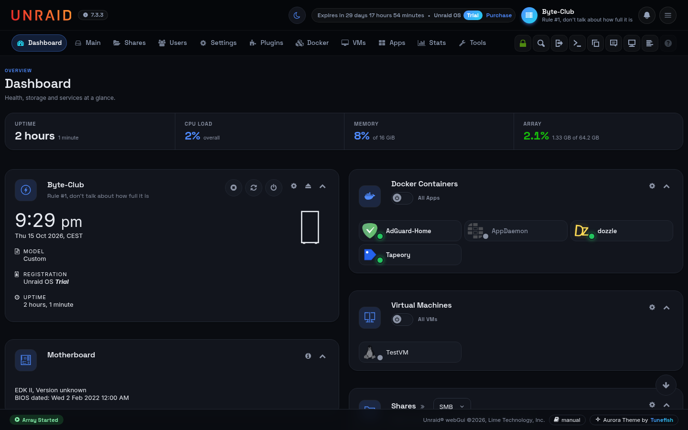

| Light palette | Sidebar layout |
| --- | --- |
| 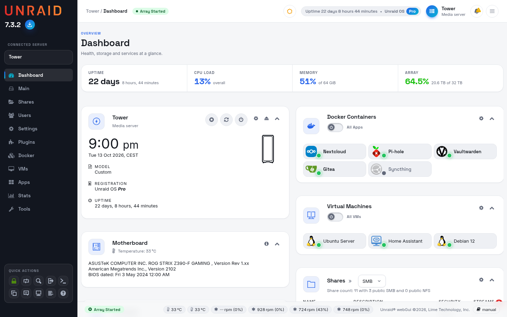 | 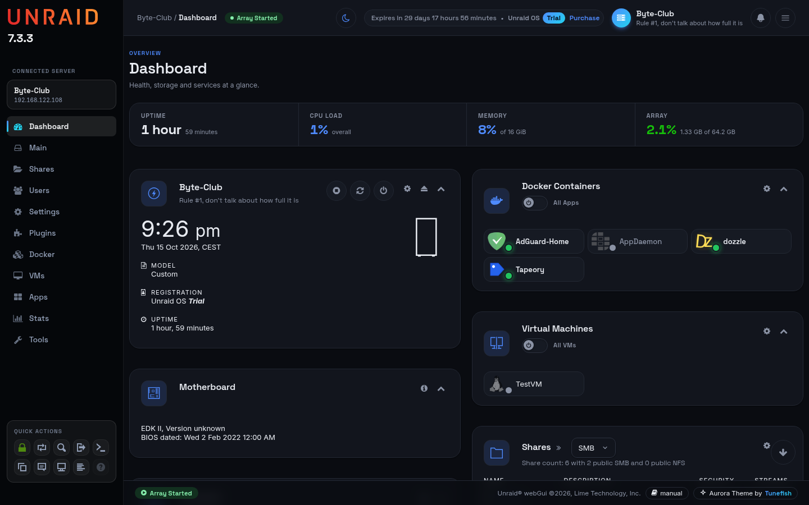 |

| Settings with favourites and search | Array Operation |
| --- | --- |
| 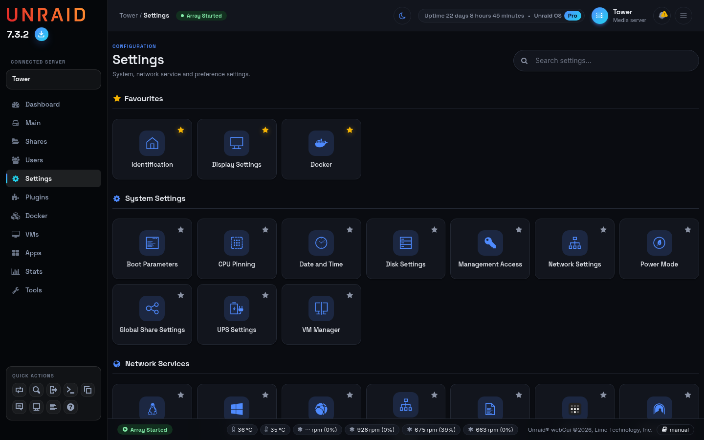 | 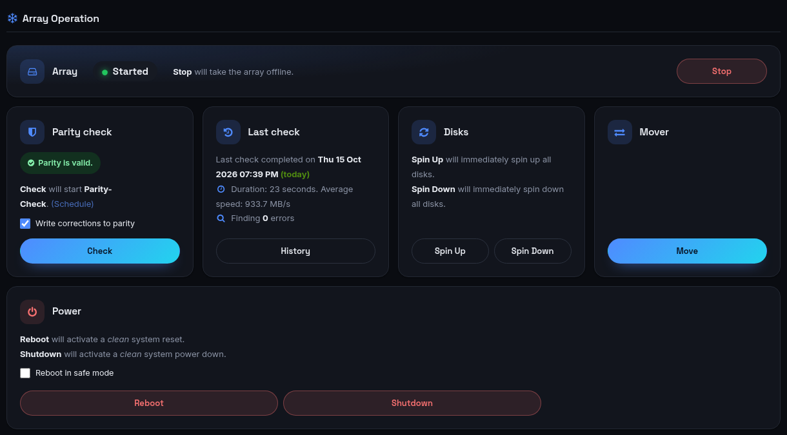 |

| Docker | VMs |
| --- | --- |
| 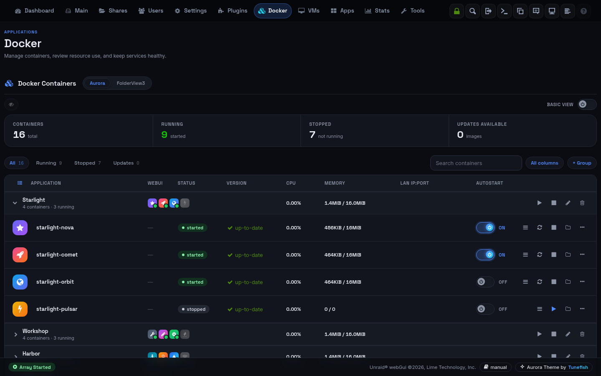 | 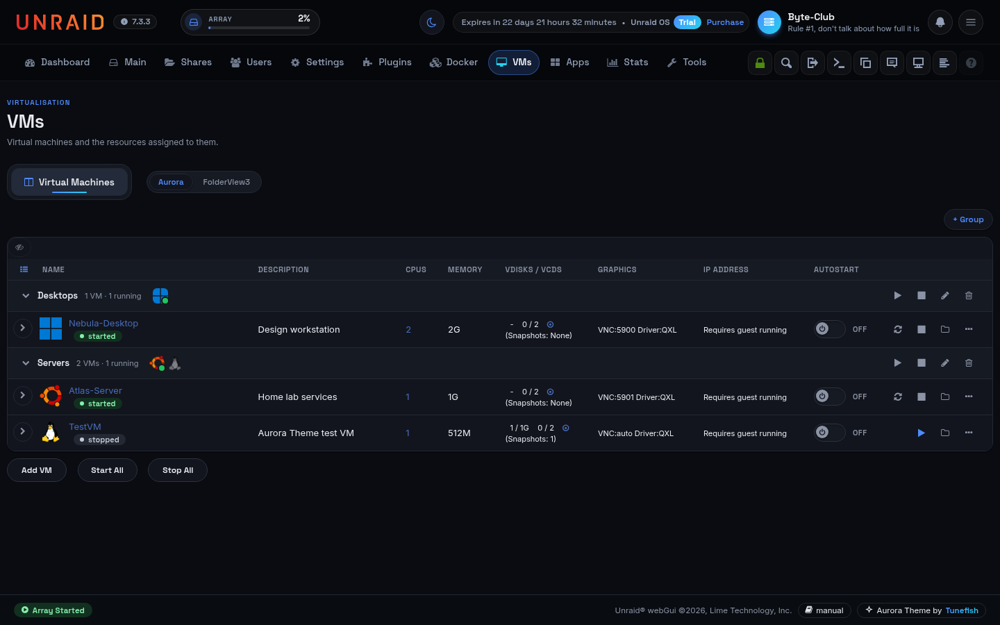 |

| GPUs on the Dashboard | Apps |
| --- | --- |
| 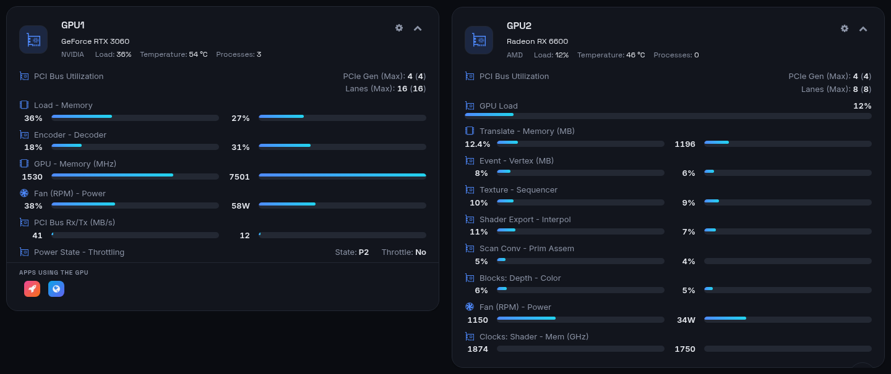 | 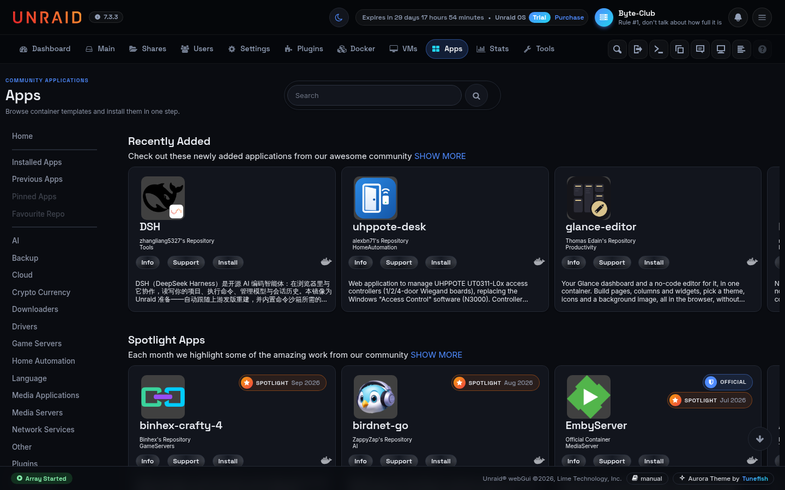 |

| Tools | Login page |
| --- | --- |
| 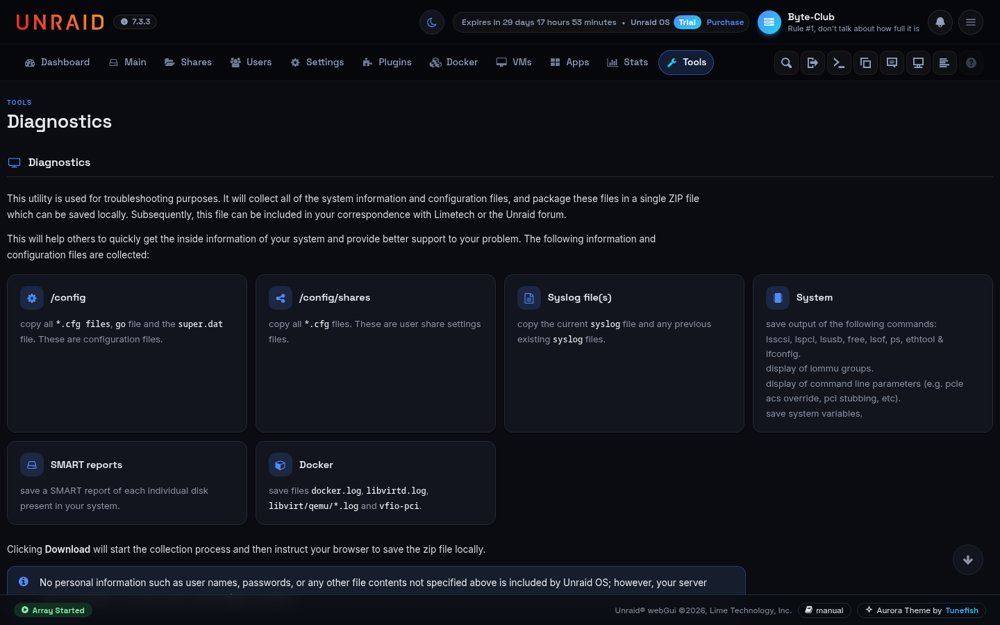 | 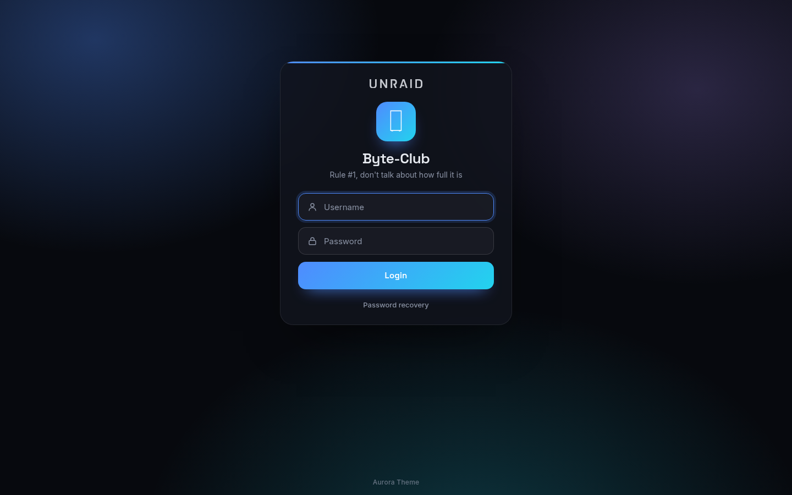 |

## Install

In Unraid, go to **Plugins → Install Plugin**, paste this address and click **Install**:

```
https://github.com/Tunefish92/Aurora-Theme/releases/latest/download/Aurora-Theme.plg
```

Or over SSH:

```
plugin install https://github.com/Tunefish92/Aurora-Theme/releases/latest/download/Aurora-Theme.plg
```

Requires Unraid 7.2 or newer. The theme follows the Dynamix colour theme in *Settings → Display Settings*: **Black** gives the dark look, **White** the light one; the round button at the top right switches between the two. Other Dynamix themes are left unchanged.

Settings are under **Settings → User Utilities → Aurora Theme**.

## What it changes

- **Look**: Inter and Space Grotesk fonts (bundled, no external requests), a blue–cyan accent, rounded cards, pill buttons, themed drop-down lists, switches, tab bars, dialogs, tooltips and notifications. Every table, including those of plugins, gets the same card style.
- **Layout**: a top bar with the server controls in one row and pill tabs with icons, the quick actions as round buttons; or an optional sidebar with the main menu, server card and quick actions (phones and tablets keep the top bar). A dark / light switch and page headings on every tab.
- **Login page**: a glass card on an aurora background, in the dark or light palette.
- **Dashboard**: tiles as cards, a summary strip (uptime, CPU, memory, array), restyled load charts, the processor's cores as a compact grid with power and temperature chips, usage rings, fans and disk bays as small cards. Clicking a container opens a dialog with all its actions. The processor tile keeps showing load, power and temperature when the Unraid API service is not running.
- **Main**: device tables with status dots, temperature and error chips and slim usage bars; Array Operation as cards (array, parity check with live progress, last check, disks, mover, power).
- **Docker**: a compact list with status, CPU, memory and a one-click WebUI button, filters and search, collapsible application groups with start/stop for a whole group, an "Orphans" section that removes unused images in one click, and a card layout on phones that also shows each container's addresses and mounts. The list refreshes by itself when containers were updated in the background. Containers keep Unraid's order and start in the order they are listed; unlock the list to drag them within and between groups or to move whole groups. With the FolderView3 plugin installed, a switch chooses between Aurora's groups and FolderView3's folders. With FolderView Plus installed, its folders arrange the Docker and VMs tabs and the Dashboard, and Aurora keeps to colours and layout, as FolderView Plus asks of themes. Support for both FolderView plugins is in beta (a note in the top bar says so); please report anything that looks off. In the container editor every port is checked while typing (range, duplicates, ports used by other containers or by the server), and the "docker allocations" list becomes a searchable overview.
- **VMs**: groups like on the Docker tab, a column with start / stop, group and menu buttons, and an expand button per VM for its disks, interfaces and snapshots, with buttons to create, revert and remove snapshots.
- **Apps** (Community Applications): a nav-style menu, the search centred in the title row with themed suggestions, "Installed", "Official" and spotlight badges as pills, page numbers that stay in place, and Change Log, Credits and Statistics as modals.
- **Settings and Tools**: a search field and a Favourites section; star any card to pin it at the top. The tool pages get readable help text: notes and warnings as callouts, command output in monospaced boxes, and the Diagnostics file list as cards. Help boxes and notices look the same everywhere.
- **Users**: user cards with avatars or coloured initials, roles, search and an "Add user" button.
- **Stats**: its own Stats tab with CPU, memory, network and disk charts, collected once a minute. It replaces the Dynamix System Statistics plugin, so remove that one first.
- **Settings page**: switches for colours, layout, enhancements and the Stats tab, an accent colour, and the fonts (Aurora's Inter and Space Grotesk, or Unraid's own Clear Sans); updates from the GitHub releases, automatically (on by default, checked weekly; after an update the next page shows what changed, with the notes of every release since your previous version) or with "Check for updates" and "Update now", from the stable releases or, if you like to test, the dev builds; a form that opens a pre-filled GitHub issue.

## Dev builds

Between releases, new fixes and features first come out as dev builds. To try them, set **Update channel** to **Dev builds (testing)** in the plugin's settings, apply, and use "Check for updates". While a dev build is installed, a small **Aurora Dev** badge in the top bar (next to the Unraid version in the sidebar layout) reminds you; it links to the settings. Dev builds can have rough edges, so please report what you find. To go back, set the channel to **Stable releases** and click "Install stable", or simply wait for the next stable release, which replaces the dev build.

## If something looks wrong

- Open any page with `?aurora=off` added to the address (for example `/Dashboard?aurora=off`, also `/login?aurora=off`) to switch the plugin off in that browser; `?aurora=on` turns it back on.
- Remove it under **Plugins**, or with `plugin remove Aurora-Theme.plg` over SSH. This also restores Unraid's own login page.
- Your own CSS and JavaScript can go in `/boot/config/plugins/Aurora-Theme/custom.css` and `custom.js`; they load after the theme and survive updates.

Please report bugs and ideas as [issues](https://github.com/Tunefish92/Aurora-Theme/issues); the settings page can fill one in for you, including the system details.

## Building from source

The plugin is a single generated file. Edit the sources in `plugin/src/` and the theme stylesheet `unraid-tapeory.css`, then run:

```
python3 plugin/build.py
```

This writes `Aurora-Theme.plg` with a version based on the current date and time.

## Buy me a coffee

Aurora Theme is free and open source, and it will stay that way. If it makes your Unraid server nicer to use and you'd like to say thanks, you can buy me a coffee:

**☕ [paypal.me/tunefish92](https://paypal.me/tunefish92)**

It's entirely voluntary and a thank-you only: it doesn't buy features, priority support or a warranty, and the software stays under the MIT license either way. Please don't send money as "Friends and Family" on PayPal.

## A note about this project

I'm a hobby programmer with an interest in coding and software development. I can read and write code, but for this project, I used Claude AI as a development assistant to help me turn my ideas into a working project.

I believe AI is a useful tool for learning, experimenting, and bringing ideas to life. I want to be transparent about how this project was created and acknowledge the role AI played in its development.

## Licence

MIT, see [LICENSE](LICENSE). The bundled fonts, Inter and Space Grotesk, are under the SIL Open Font License; their licence texts are in `plugin/src/fonts/`.

Theme by [Tunefish](https://github.com/Tunefish92).
